<div dir="rtl">

# شرح اقتراحات تحسين تجربة المستخدم 🌿

هاد الملف بيشرح كل اقتراح طلبت توضيحه، مع صور تخيلية لشكل البوت بعد التعديل، وأمثلة للرسائل.

الصور كلها بمجلد `mockups` جنب هاد الملف. بكل صورة، الشاشة اليمين هي «قبل» أو «الخطوة الأولى»، والشاشة اليسار هي «بعد» أو «الخطوة التانية»، لأنو منقرأ من اليمين لليسار.

---

## الفهرس

1. [ملخص قراراتك](#ملخص)
2. [شرح الأفكار يلي طلبت توضيحها](#شرح)
3. [الأفكار يلي وافقت عليها وكيف رح تنفذ](#موافق)
4. [الأفكار يلي رفضتها أو تأجلت](#مرفوض)
5. [ترتيب التنفيذ المقترح](#ترتيب)

---

<a id="ملخص"></a>

## 1. ملخص قراراتك

| الرقم | الفكرة | القرار |
|---|---|---|
| 1 | الأوقات بنظام 12 ساعة وكتابة الوقت بشكل طبيعي | 🤔 مشروحة تحت |
| 2 | تأكيد قبل إيقاف التذكير | ✅ موافق |
| 3 | الأزرار السفلية ما تختفي | 🤔 مشروحة تحت |
| 4 | دمج «مساعدة» و«شرح البوت» | ✅ موافق |
| 5 | رسالة شرح البوت | 🤔 مشروحة تحت (مدموجة مع 4) |
| 6 | قائمة الأوامر بالعربي | ✅ موافق |
| 7 | تلميح ذكي حسب الوقت (بدون منع) | 🤔 مشروحة تحت |
| 8 | البوت يتذكر «مختصر أو كامل» | 🤔 مشروحة تحت |
| 9 | إعداد بضغطة وحدة | 🤔 مشروحة تحت |
| 10 | الأذكار توصل مع التذكير مباشرة | 🤔 مشروحة تحت |
| 11 | تأكيد الإعدادات بجملة عادية | 🤔 مشروحة تحت |
| 12 | عدّاد التكرار | ❌ لا |
| 13 | التسجيل الصوتي | ❌ لا |
| 14 | صور بدل ملف PDF | 🤔 مشروحة تحت |
| 15 | رسائل خطأ لطيفة ومناسبة لكل حالة | 🤔 مشروحة تحت |
| 16 | فهم الكلام العادي (ومعه ذكاء اصطناعي بسيط) | 🤔 مشروحة تحت |
| 17 | أزرار أكبر بالقراءة | ✅ موافق |
| 18 | شرح تكبير الخط | ✅ موافق |
| 19 و 20 | الوضع المبسّط ورابط العيلة | 🤔 مشروحة تحت |
| 21 | أوقات مرتبطة بالصلاة | ⏸ مؤجلة (صعبة) |
| 22 | تحديد المنطقة تلقائيًا | 🤔 مشروحة تحت |
| 23 | تذكير تاني إذا ما فتح | 🤔 مشروحة تحت |
| 24 | إخفاء الفضل والمصدر خلف «اضغط للعرض» | ✅ موافق |
| 25 | تشكيل كامل ومسافات واضحة | ✅ موافق |
| 26 | الإيموجيات | ✅ منخليها متل ما هي |
| 27 | الأرقام | ✅ أرقام غربية بس (1، 2، 3) |
| 28 | رسائل لطيفة ودافئة | ✅ موافق |
| 29 | ملخص أسبوعي | 🤔 مشروحة تحت |
| 30 | تتبع وين الناس بيعلقوا | 🤔 مشروحة تحت |

---

<a id="شرح"></a>

## 2. شرح الأفكار يلي طلبت توضيحها

---

### الفكرة 1: كيف رح يدخّل المستخدم الوقت؟

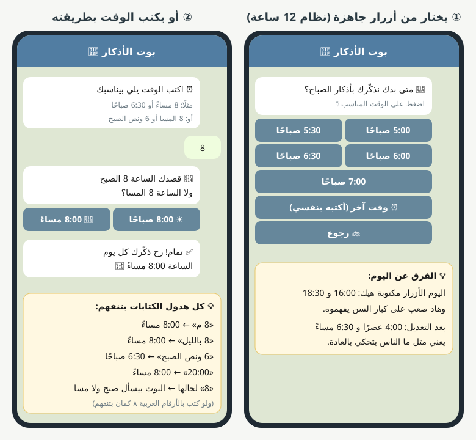

#### الطريقة الأولى: أزرار جاهزة (الأسهل)

اليوم الأزرار مكتوبة بنظام 24 ساعة، متل:

> 16:00 · 16:30 · 17:00 · 18:30

وهاد بيلخبط كتير ناس، خصوصًا الكبار.

بعد التعديل بتصير مكتوبة متل ما الناس بتحكي:

> 4:00 عصرًا · 4:30 عصرًا · 5:00 مساءً · 6:30 مساءً

المستخدم بيضغط على الزر وخلص، ما بيكتب شي.

#### الطريقة التانية: يكتب الوقت بنفسه

إذا ما لاقى الوقت يلي بدو ياه، بيضغط «⏰ وقت آخر» وبيكتب. والبوت بيفهم الكتابة الطبيعية:

| المستخدم بيكتب | البوت بيفهم |
|---|---|
| 8 م | 8:00 مساءً |
| 8 مساءً | 8:00 مساءً |
| 8 المسا | 8:00 مساءً |
| 8 بالليل | 8:00 مساءً |
| 6 الصبح | 6:00 صباحًا |
| 6 ونص الصبح | 6:30 صباحًا |
| 7 وربع المسا | 7:15 مساءً |
| 8 إلا ربع الصبح | 7:45 صباحًا |
| 5 العصر | 5:00 مساءً |
| 12 الضهر | 12:00 ظهرًا |
| 20:00 | 8:00 مساءً |
| ٨ م (أرقام عربية) | 8:00 مساءً |

#### إذا كتب رقم لحاله، متل «8»

البوت ما بيخمّن، بيسأله:

> 🤔 قصدك الساعة 8 الصبح ولا الساعة 8 المسا؟

ومعها زرّين: «☀️ 8:00 صباحًا» و«🌙 8:00 مساءً». (هالجزء موجود جزئيًا بالبوت اليوم، رح نخليه أوضح.)

#### بعد الحفظ

البوت بيأكد بجملة واضحة:

> ✅ تمام! رح ذكّرك كل يوم الساعة 8:00 مساءً 🌙

**ملاحظة تقنية:** بقاعدة البيانات الوقت بيضل محفوظ متل اليوم (نظام 24 ساعة). التغيير بس بطريقة العرض والكتابة.

---

### الفكرة 3: الأزرار السفلية ما تختفي

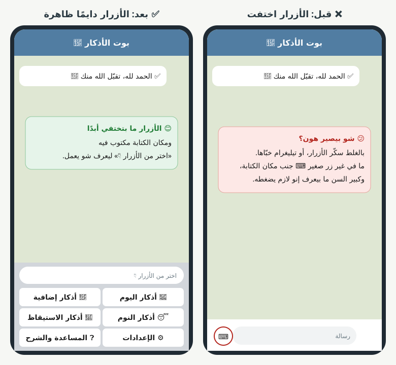

#### شو المشكلة اليوم؟

الأزرار يلي تحت (أذكار اليوم، الإعدادات...) ممكن تختفي إذا:

- المستخدم ضغط بالغلط على زر إخفاء الكيبورد.
- أو تيليغرام خبّاها لما فتح لوحة الكتابة.

وقتها ما بيضل غير أيقونة صغيرة ⌨️ جنب مكان الكتابة، وكبير السن ما بيعرف إنو لازم يضغطها ليرجّع الأزرار. فبيحس إنو البوت «خرب».

#### شو الحل؟

تيليغرام بيسمح نقلّه: «خلّي هالأزرار ظاهرة دايمًا». فبتصير الأزرار ثابتة تحت متل لوحة مفاتيح.

وكمان منكتب بمكان الكتابة جملة خفيفة:

> اختر من الأزرار 👇

حتى إذا حدا حاول يكتب، يعرف إنو الأسهل يضغط زر.

**التنفيذ:** تعديل صغير جدًا بملف واحد (إضافة خيارين لإعدادات الكيبورد).

---

### الفكرة 5 (مع 4): رسالة شرح البوت وطريقة استخدامه

أنت بدك رسالة بتشرح البوت لمين ما بيعرف يستخدمه، وأنا اقترحت ندمج «مساعدة» و«شرح البوت». الحل يلي بيجمع الفكرتين:

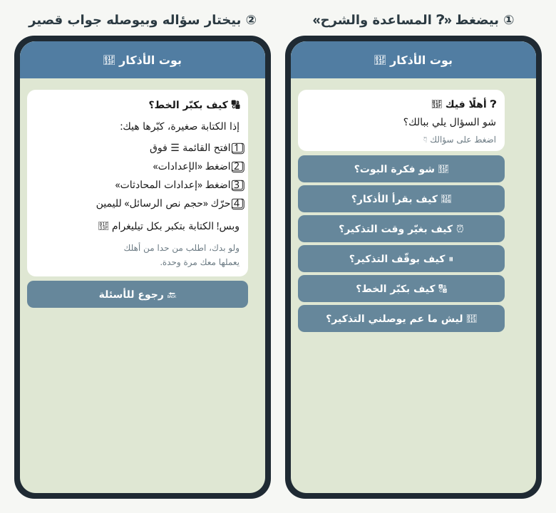

#### بدل رسالة طويلة وحدة: أسئلة قصيرة

زر واحد تحت اسمه **«❓ المساعدة والشرح»**. لما يضغطه بتطلعله قائمة أسئلة، وكل سؤال إلو جواب قصير:

| السؤال | الجواب المختصر |
|---|---|
| 🌿 شو فكرة البوت؟ | البوت بيذكّرك كل يوم بأذكار الصباح والمساء بالوقت يلي بتختاره، وبتقرأها من هون مباشرة. |
| 📖 كيف بقرأ الأذكار؟ | اضغط «📖 أذكار اليوم» تحت، اختار الصباح أو المساء، واقرأ واضغط «التالي» لتنتقل للذكر يلي بعده. |
| ⏰ كيف بغيّر وقت التذكير؟ | اضغط «⚙️ الإعدادات»، بعدين «وقت الصباح» أو «وقت المساء»، واختار الوقت الجديد. |
| ⏸ كيف بوقّف التذكير؟ | من «⚙️ الإعدادات» اضغط «إيقاف التذكير». إعداداتك بتضل محفوظة وبترجع تشغّلها بأي وقت. |
| 🔠 كيف بكبّر الخط؟ | خطوات بسيطة من إعدادات تيليغرام (مشروحة بالصورة فوق). |
| 🔕 ليش ما عم يوصلني التذكير؟ | تأكد إنك ما كتمت صوت المحادثة، وإنو التذكير مشغّل من الإعدادات. |

#### ليش هيك أحسن من رسالة طويلة؟

- كبير السن ما بيقرأ 15 سطر، بس بيقرأ سطرين.
- كل واحد بيضغط على السؤال يلي ببالو بالضبط.
- منقدر نزيد أسئلة بعدين بسهولة.

#### وأول مرة بيفتح البوت؟

رسالة ترحيب قصيرة (3 أسطر بس) فيها زر «🌿 شو فكرة البوت؟» لمين بدو يعرف أكتر، وزر «🚀 يلا نبدأ».

---

### الفكرة 7: تلميح ذكي حسب الوقت (بدون ما نمنع شي)

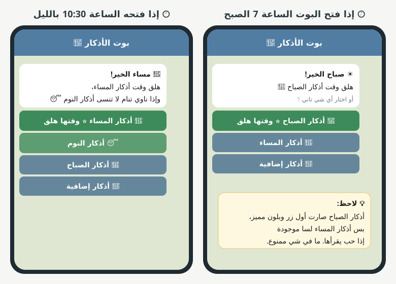

#### الفكرة

لما يضغط «📖 أذكار اليوم»، كل الخيارات بتضل موجودة (الصباح والمساء والإضافية). بس البوت بيشوف الساعة عند المستخدم:

- الخيار المناسب لهالوقت بيصير **أول زر**، وبلون مميز، ومكتوب جنبه «⭐ وقتها هلق».
- وفوق الأزرار جملة ترحيب حسب الوقت: «☀️ صباح الخير!» أو «🌙 مساء الخير!».

يعني منساعده يختار، بس ما منجبره.

#### الأوقات (حسب ساعة بلد المستخدم)

| الساعة عنده | شو بيتميّز |
|---|---|
| من 3:00 الفجر لـ 11:59 الضهر | 🌅 أذكار الصباح |
| من 12:00 الضهر لـ 2:59 العصر | ما في تمييز (كل الأزرار عادية) |
| من 3:00 العصر لـ 8:59 المسا | 🌙 أذكار المساء |
| من 9:00 بالليل لـ 2:59 بعد نص الليل | 🌙 أذكار المساء + 😴 أذكار النوم |

هالأوقات تقريبية ومنقدر نعدّلها متل ما بدك.

---

### الفكرة 8: البوت يتذكر «مختصر أو كامل»

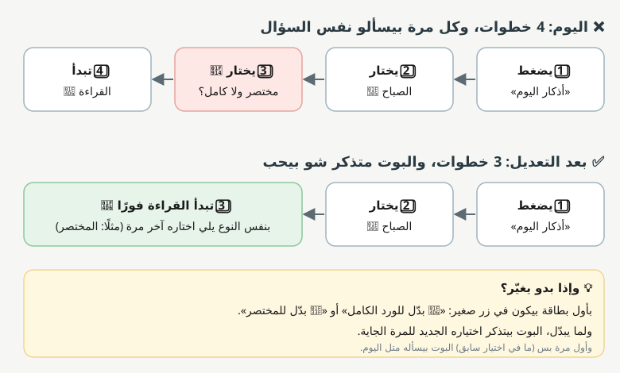

#### اليوم

كل مرة بيفتح أذكار الصباح أو المساء، البوت بيسأله: «مختصر ولا كامل؟». حتى لو كان كل يوم بيختار المختصر، بينسأل نفس السؤال.

#### بعد التعديل

- **أول مرة بس** البوت بيسأله متل اليوم.
- بعدين البوت بيحفظ اختياره، والمرات الجاية بتبلّش القراءة فورًا بنفس النوع.
- إذا بدو يغيّر، بأول بطاقة في زر صغير: «📖 بدّل للورد الكامل» أو «🌿 بدّل للمختصر».
- ولما يبدّل، البوت بيتذكر اختياره الجديد.

**النتيجة:** خطوة أقل كل مرة، وسؤال أقل بيحيّر الكبير.

---

### الفكرة 9: إعداد بضغطة وحدة

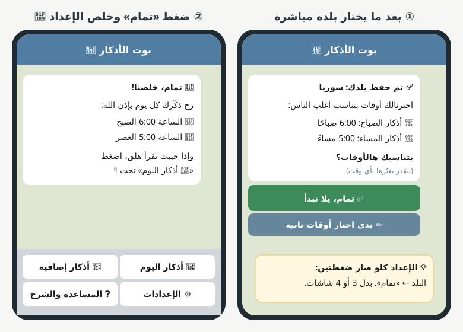

#### اليوم

الإعداد 3 شاشات على الأقل: البلد، بعدين وقت الصباح، بعدين وقت المساء.

#### بعد التعديل

بعد ما يختار بلده، البوت بيقترح أوقات بتناسب أغلب الناس:

> ✅ تم حفظ بلدك: سوريا
>
> اخترنالك أوقات بتناسب أغلب الناس:
>
> 🌅 أذكار الصباح: 6:00 صباحًا
>
> 🌙 أذكار المساء: 5:00 مساءً
>
> بتناسبك هالأوقات؟

ومعها زرّين:

- «✅ تمام، يلا نبدأ» ← بيحفظ وبيخلص الإعداد.
- «✏️ بدي اختار أوقات تانية» ← بيكمل متل اليوم (يختار وقت الصباح والمساء).

يعني الإعداد كلو بيصير **ضغطتين**: البلد، و«تمام».

---

### الفكرة 10: الأذكار توصل مع التذكير مباشرة

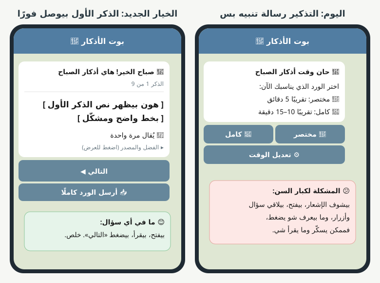

#### اليوم

بوقت التذكير بتوصله رسالة: «حان وقت أذكار الصباح، اختر مختصر أو كامل». لازم يفتح، ويقرأ، ويختار، وبعدين بتبلّش الأذكار.

#### الخيار الجديد

بوقت التذكير بتوصله **أول بطاقة من الأذكار مباشرة**. بيفتح الإشعار، بيلاقي الذكر الأول جاهز، بيقرأ وبيضغط «التالي». ما في أي سؤال.

#### هل رح نلغي الطريقة الحالية؟

لا. بيصير في الإعدادات خيار اسمه «شكل التذكير»:

- **🔔 تنبيه بس** (متل اليوم): مناسب لمين بدو يختار كل مرة.
- **📖 الأذكار مباشرة**: مناسب لكبار السن، ورح يكون مشغّل تلقائيًا بالوضع المبسّط.

ونوع الورد (مختصر أو كامل) بيكون آخر نوع اختاره (الفكرة 8).

---

### الفكرة 11: تأكيد الإعدادات بجملة عادية

#### اليوم، بعد الإعداد بتوصله رسالة متل هيك:

> ✅ تم ضبط تذكيراتك
>
> 🌍 المنطقة: سوريا
>
> 🌅 الصباح: 6:00 ص
>
> 🌙 المساء: 5:00 م
>
> 🔔 التذكير: مفعّل

هي صحيحة، بس شكلها متل «جدول»، والكبير لازم يركّبها بعقله.

#### بعد التعديل:

> 🎉 تمام، خلصنا!
>
> رح ذكّرك كل يوم بإذن الله:
>
> 🌅 الساعة 6:00 الصبح
>
> 🌙 الساعة 5:00 العصر
>
> وإذا حبيت تقرأ هلق، اضغط «📖 أذكار اليوم» تحت 👇

نفس المعلومات، بس مكتوبة متل ما حدا بيحكي معك. والمنطقة ما منكررها لأنو المستخدم ما بيهمه يشوفها كل مرة (بتضل ظاهرة بالإعدادات).

---

### الفكرة 14: صور بدل ملف PDF

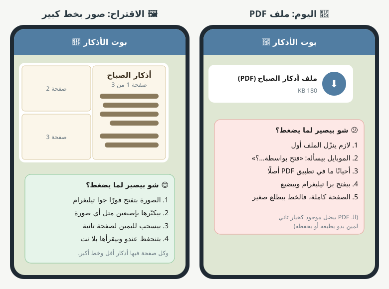

#### شو المشكلة بالـ PDF؟

لما المستخدم يضغط «📥 أرسل الورد كاملًا»، بيوصله ملف PDF. ولما بدو يفتحه:

1. لازم ينزّل الملف أول.
2. الموبايل بيسأله: «فتح بواسطة أي تطبيق؟»، وكبير السن ما بيعرف شو يختار.
3. أحيانًا ما في تطبيق PDF على الموبايل أصلًا.
4. الملف بيفتح برا تيليغرام، وبعدين ما بيعرف كيف يرجع.
5. الصفحة كبيرة فالخط بيطلع صغير.

#### شو الحل؟

البوت بيبعت الورد كـ **صور** (متل صفحات كتاب)، كل صورة فيها كم ذكر بخط كبير وواضح:

1. بيضغط على الصورة، فبتفتح فورًا **جوا تيليغرام**.
2. بيكبّرها بإصبعين متل أي صورة من أولاده.
3. بيسحب لليمين أو اليسار لينتقل للصفحة يلي بعدها.
4. الصور بتنحفظ عنده وبيقرأها بلا إنترنت.

**وملف الـ PDF؟** بيضل موجود كخيار تاني لمين بدو يطبعه.

**التنفيذ:** البوت أصلًا عم يجهّز الـ PDF من تصميم جاهز، فمنحوّل نفس التصميم لصور بدل ما يكون ملف.

---

### الفكرة 15: رسائل خطأ لطيفة ومناسبة لكل حالة

متل ما طلبت: مو بس للرسائل الصوتية، لكل خطأ رسالة خاصة فيه، لطيفة وواضحة، ودايمًا معها **شو يعمل بعدها**.

| شو صار | الرسالة المقترحة |
|---|---|
| بعت رسالة صوتية 🎤 | ما بقدر أسمع الرسائل الصوتية 🙏 بس فيك تضغط على الأزرار تحت وأنا بساعدك 👇 |
| بعت صورة 🖼 | صورة حلوة 🌸 بس أنا بوت أذكار وما بقدر أفهم الصور. اختار من الأزرار تحت 👇 |
| بعت ملصق (ستيكر) 😄 | 😊 أهلًا فيك! إذا بدك تقرأ الأذكار، اضغط «📖 أذكار اليوم» تحت. |
| بعت فيديو 🎥 | ما بقدر أشوف الفيديوهات 🙏 اختار من الأزرار تحت 👇 |
| بعت ملف 📎 | ما بقدر أفتح الملفات 🙏 اختار من الأزرار تحت 👇 |
| بعت جهة اتصال 📞 | شكرًا 🌿 بس ما بحتاج أرقام. اختار من الأزرار تحت 👇 |
| بعت موقع بوقت ما طلبناه 📍 | وصلني موقعك 🌿 إذا بدك تغيّر بلدك، روح على «⚙️ الإعدادات». |
| كتب كلام ما فهمه البوت | ما فهمت قصدك 🤔 جرّب تضغط على أحد الأزرار تحت 👇 (أو منستعمل الفكرة 16) |
| كتب وقت غلط | ما قدرت أفهم هالوقت 🤔 جرّب تكتبه هيك: 8 مساءً أو 6:30 صباحًا |
| كتب اسم بلد ما لقيناه | ما لقيت «...» 🤔 جرّب تكتب اسم العاصمة، أو اختار بلدك من القائمة 👇 |
| ضغط زر قديم من رسالة قديمة | هالزر صار قديم 🌿 هاي أحدث قائمة إلك 👇 (ومنبعتله القائمة الجديدة) |
| ضغط على تذكير مبارح | هالتذكير كان لمبارح 🌙 بس فيك تقرأ أذكار اليوم هلق 👇 |
| ضغط نفس الزر مرتين بسرعة | ما منعمل شي ولا منبعت رسالة (حتى ما يتلخبط) |
| الأذكار ما جهزت (مشكلة عنا) | صار في مشكلة صغيرة عنا 🙏 جرّب كمان شوي، وإن شاء الله بتزبط. |
| تيليغرام ما رد (مشكلة نت) | الإنترنت ضعيف شوي 📶 جرّب كمان مرة بعد دقيقة. |

**قواعد كل رسائل الخطأ:**

- ما فيها لوم («أنت غلطت») أبدًا.
- قصيرة: سطر أو سطرين.
- دايمًا بتقول شو يعمل بعدها، ومعها زر إذا بيلزم.
- إيموجي لطيف بأولها.

---

### الفكرة 16: فهم الكلام العادي (ومعه ذكاء اصطناعي بسيط)

**الجواب المختصر:** إي ممكن، ومو صعب، بس الأحسن نعمله على مرحلتين.

#### المرحلة الأولى: قاموس كلمات (بدون ذكاء اصطناعي)

منكتب قائمة كلمات، وكل كلمة إلها عمل:

| إذا كتب كلمة فيها... | البوت بيعمل |
|---|---|
| صباح، الصبح، الصباح | بيفتح أذكار الصباح |
| مسا، المساء، المسا | بيفتح أذكار المساء |
| نوم، نام، النوم | بيفتح أذكار النوم |
| صحيت، استيقاظ، فقت | بيفتح أذكار الاستيقاظ |
| مساعدة، ساعدني، ما فهمت | بيفتح المساعدة |
| وقف، بطّل، ما بدي تذكير | بيسأل: بدك توقف التذكير؟ |
| شغّل، رجّع التذكير | بيشغّل التذكير |
| وقت، غيّر الساعة | بيفتح تعديل الوقت |
| السلام عليكم | وعليكم السلام ورحمة الله 🌿 + القائمة |
| شكرًا، جزاك الله خير | وإياك 🤍 + القائمة |

هاد مجاني وسريع، وبيغطي أغلب الحالات.

#### المرحلة التانية: ذكاء اصطناعي بس للحالات الصعبة

إذا الكلام ما طابق ولا كلمة من القاموس، البوت بيبعت الجملة لنموذج ذكاء اصطناعي صغير ورخيص، ومنسأله سؤال واحد بس: «شو بدو هالمستخدم من هالقائمة؟».

أمثلة:

| المستخدم كتب | الذكاء الاصطناعي فهم | البوت عمل |
|---|---|---|
| بدي غيّر وقت المسا للساعة 9 | تغيير وقت المساء إلى 9:00 مساءً | بيسأل: «بدك نغيّر وقت المساء لـ 9:00 مساءً؟» مع زر ✅ وزر ❌ |
| ليش ما عم يجيني شي الصبح | مشكلة بالتذكير | بيبعت جواب «ليش ما عم يوصلني التذكير؟» |
| بدي اقرا الاذكار يلي قبل ما نام | أذكار النوم | بيفتح أذكار النوم |
| انا بالسعودية هلق مو بسوريا | تغيير البلد | بيسأل: «بدك نغيّر بلدك للسعودية؟» |

#### قواعد مهمة للأمان

- الذكاء الاصطناعي **ما بيكتب أذكار ولا أحكام دينية أبدًا**. بس بيختار من قائمة أفعال جاهزة.
- أي تغيير بالإعدادات لازم المستخدم يأكده بزر قبل ما يتنفذ.
- إذا ما فهم، البوت بيرد رسالة «ما فهمت» اللطيفة.

#### الكلفة والمتطلبات

- منحتاج حساب عند شركة ذكاء اصطناعي ومفتاح (API key).
- الكلفة قليلة جدًا، لأنو بيشتغل بس على الجمل يلي ما فهمها القاموس.
- الرد بياخد ثانية أو ثانيتين زيادة.
- الجملة بتنبعت لشركة خارجية، فلازم نذكر هالشي بسياسة الخصوصية.

**اقتراحي:** نبلّش بالقاموس، وبعد ما نشوف شو الجمل يلي ما عم تنفهم (من الفكرة 30)، منقرر إذا بدنا الذكاء الاصطناعي.

---

### الفكرتين 19 و 20: الوضع المبسّط ورابط العيلة

#### شو هو الوضع المبسّط؟

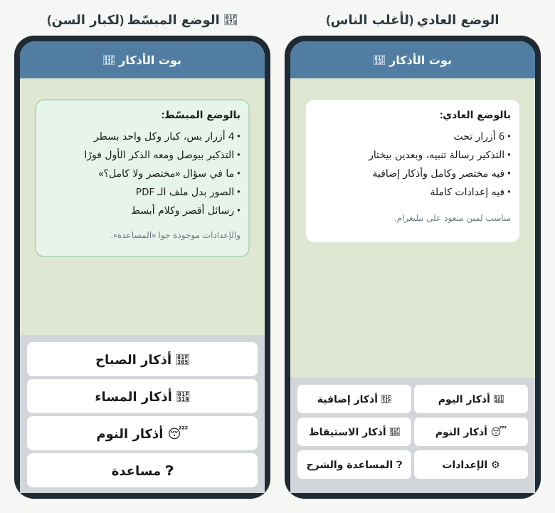

هو «نسخة أسهل» من نفس البوت. نفس الأذكار ونفس التذكيرات، بس بشكل أبسط. بتشغّله مرة وحدة، وبيغيّر كذا شغلة سوا:

| الشي | الوضع العادي | الوضع المبسّط |
|---|---|---|
| الأزرار تحت | 6 أزرار، كل سطر فيه زرّين | 4 أزرار كبار، كل زر بسطر |
| التذكير | رسالة تنبيه، وبعدين بيختار | الذكر الأول بيوصل مباشرة (الفكرة 10) |
| سؤال «مختصر ولا كامل؟» | موجود أول مرة | ما في، دايمًا المختصر |
| أذكار إضافية | موجودة | مخفية (لتخفيف الزحمة) |
| الورد كامل | ملف PDF أو صور | صور بس (الفكرة 14) |
| التذكير التاني إذا ما فتح | مطفي | مشغّل (الفكرة 23) |
| الرسائل | عادية | أقصر وكلامها أبسط |
| الإعدادات | زر تحت | جوا «❓ مساعدة» (حتى ما يغيّر شي بالغلط) |

#### كيف بينشغل؟

3 طرق:

1. **من الإعدادات:** زر «👴 الوضع المبسّط: تشغيل / إيقاف».
2. **بأول الإعداد:** البوت بيسأل: «بدك البوت بشكل بسيط وسهل؟» مع زرّين «إي، بسّطه» و«لا، عادي».
3. **من رابط العيلة** (تحت).

#### رابط العيلة: كيف بيشتغل؟

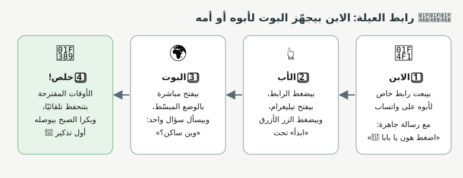

الفكرة: كتير كبار سن ما بيعرفوا يلاقوا البوت أو يضبطوه. فالابن أو البنت بيعملوا هالشي عنهم:

1. **الابن** بيفتح البوت وبيضغط «👨‍👩‍👦 جهّز البوت لحدا من أهلي». البوت بيعطيه رابط خاص ورسالة جاهزة ليبعتها على واتساب:

   > بابا، هاد بوت بيذكّرك بأذكار الصباح والمساء 🌿 اضغط على الرابط، وبعدين اضغط الزر الأزرق «ابدأ» تحت.

2. **الأب** بيضغط على الرابط، بيفتح تيليغرام، وبيضغط «ابدأ».
3. **البوت** بيعرف إنو جاي من رابط العيلة، فبيفتح مباشرة بالوضع المبسّط، وبيسأل سؤال واحد بس: «وين ساكن؟».
4. **خلص!** الأوقات المقترحة بتنحفظ تلقائيًا، وتاني يوم الصبح بيوصله أول تذكير.

**تقنيًا:** تيليغرام بيسمح نحط كلمة بآخر رابط البوت، والبوت بيقراها لما المستخدم يضغط «ابدأ». فالرابط بيكون متل:

</div>

```
https://t.me/اسم_البوت?start=simple
```

<div dir="rtl">

ما منقدر نضبط حساب حدا تاني بدون ما هو يضغط «ابدأ» بنفسه (تيليغرام بيمنع هالشي). بس هيك صارت كل الشغلة ضغطتين أو تلاتة عنده.

---

### الفكرة 22: تحديد المنطقة تلقائيًا

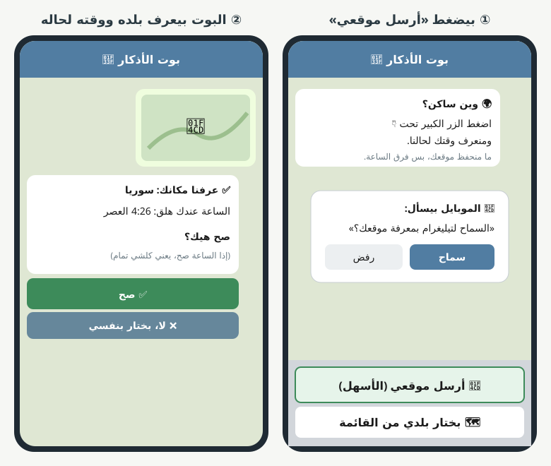

#### الحقيقة أول شي

تيليغرام **ما بيعطي البوت** بلد المستخدم أو موقعه أو رقمه بشكل تلقائي، حفاظًا على الخصوصية. فما في طريقة «أوتوماتيك 100%» بدون ما المستخدم يضغط شي.

بس في طريقة **قريبة كتير من التلقائي**: ضغطة وحدة.

#### الطريقة المقترحة: زر «📍 أرسل موقعي»

1. البوت بيسأل «🌍 وين ساكن؟» وتحت في زر كبير: «📍 أرسل موقعي (الأسهل)».
2. بيضغطه، والموبايل بيسأله «السماح لتيليغرام بمعرفة موقعك؟»، فبيضغط «سماح».
3. البوت بيعرف من الموقع البلد وفرق الساعة لحاله.
4. البوت بيأكد بطريقة بسيطة: **بيقلّه الساعة عنده هلق**:

   > ✅ عرفنا مكانك: سوريا
   >
   > الساعة عندك هلق: 4:26 العصر
   >
   > صح هيك؟

   إذا الساعة صح، يعني كلشي مضبوط. وهاد أسهل للكبير من إنو يفهم «منطقة زمنية».

5. وتحت الزر الكبير في زر تاني: «🗺 بختار بلدي من القائمة» لمين ما بدو يبعت موقعه.

#### مقارنة الطرق الممكنة

| الطريقة | كم ضغطة | ميزاتها | مشاكلها |
|---|---|---|---|
| 📍 إرسال الموقع | ضغطة + «سماح» | دقيقة، وبتعرف حتى المدينة بأمريكا | بتشتغل عالموبايل بس (مو عالكمبيوتر). وبعض الناس بيخافوا يبعتوا موقعهم |
| 📞 إرسال الرقم | ضغطة + «مشاركة» | من مفتاح الدولة (+963) منعرف البلد | الناس بتتحسس من إرسال رقمها. وما بتنفع لدول فيها كذا توقيت |
| 🗺 القائمة (متل اليوم) | ضغطة | ما بتحتاج أي إذن | لازم يدوّر على بلده بين 22 بلد |

**اقتراحي:** زر الموقع كخيار أول، والقائمة كخيار احتياطي. وعلى الكمبيوتر بتطلع القائمة بس.

**الخصوصية:** ما منحفظ الموقع نفسه أبدًا. منستعمله لحظة لنعرف فرق الساعة، وبعدين منرميه. ومنكتب هالشي للمستخدم بالرسالة.

**التنفيذ:** تحويل الموقع لفرق ساعة بيحتاج مكتبة جاهزة أو خدمة مجانية. شغلة متوسطة الصعوبة، مو كبيرة.

---

### الفكرة 23: تذكير تاني إذا ما فتح التذكير الأول

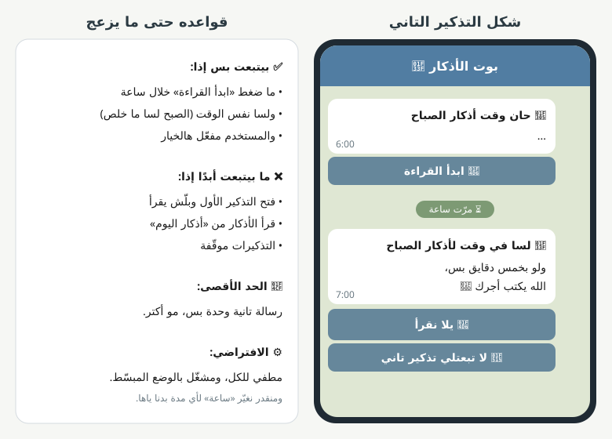

#### كيف بيشتغل؟

- الساعة 6:00 بيوصله التذكير العادي.
- إذا مرّت ساعة وما ضغط «ابدأ القراءة»، بتوصله رسالة وحدة لطيفة:

  > 🌿 لسا في وقت لأذكار الصباح
  >
  > ولو بخمس دقايق بس، الله يكتب أجرك 🤍

  ومعها زر «📖 يلا نقرأ»، وزر «🔕 لا تبعتلي تذكير تاني».

#### قواعده حتى ما يزعج

- **رسالة وحدة بس**، ما في تالتة.
- ما بتنبعت إذا كان فتح التذكير وبلّش يقرأ.
- ما بتنبعت إذا الوقت خلص (مثلًا صار العصر).
- ما بتنبعت إذا التذكيرات موقّفة.
- **مطفية للكل افتراضيًا**، ومشغّلة بالوضع المبسّط بس.
- مدة «ساعة» منقدر نغيّرها.

**ملاحظة:** حتى نعرف إذا قرأ الأذكار من «أذكار اليوم» بدل التذكير، لازم نبلّش نسجّل هالقراءة (اليوم ما عم تنسجل). هالشي بيفيدنا كمان بالفكرة 29 و 30.

---

### الفكرة 29: الملخص الأسبوعي

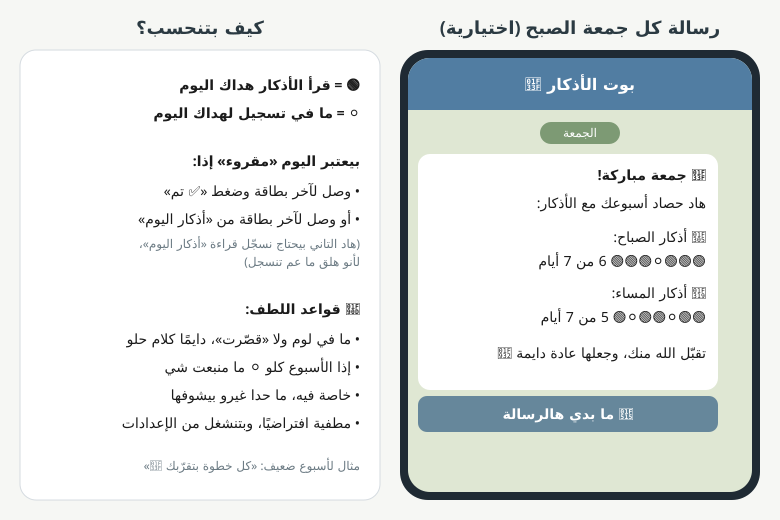

#### كيف بيكون؟

كل جمعة الصبح (للي مشغّلها بس) بتوصله رسالة:

> 🌿 جمعة مباركة!
>
> هاد حصاد أسبوعك مع الأذكار:
>
> 🌅 أذكار الصباح: 🟢🟢🟢⚪🟢🟢🟢 6 من 7 أيام
>
> 🌙 أذكار المساء: 🟢🟢⚪🟢🟢⚪🟢 5 من 7 أيام
>
> تقبّل الله منك، وجعلها عادة دايمة 🤲

#### شو معنى الدوائر؟

- 🟢 = بهداك اليوم قرأ الأذكار لآخرها.
- ⚪ = ما في تسجيل لهداك اليوم.

#### متى منعتبر اليوم «مقروء»؟

- إذا وصل لآخر بطاقة من التذكير وضغط «✅ تم» (هاد موجود اليوم).
- أو إذا وصل لآخر بطاقة من «أذكار اليوم» (هاد بيحتاج نضيف تسجيل).

#### قواعد اللطف

- ما في لوم أبدًا. الأسبوع الضعيف رسالته متل: «كل خطوة بتقرّبك 🌿».
- إذا الأسبوع كلو فاضي، ما منبعت شي.
- خاصة فيه، ما حدا غيرو بيشوفها.
- **مطفية افتراضيًا**، وبتنشغل من الإعدادات بزر «📊 ملخص أسبوعي».

---

### الفكرة 30: تتبع وين الناس بيعلقوا

**الجواب المختصر:** مو صعب، تقريبًا يوم شغل.

#### شو منسجّل؟

جدول صغير بقاعدة البيانات، كل سطر فيه: مين المستخدم، شو صار، وإيمتى. أمثلة للأحداث:

| الحدث | شو بيعلّمنا |
|---|---|
| بلّش الإعداد | كم واحد فتح البوت |
| خلّص الإعداد | كم واحد كمّل (والفرق بينهم = يلي علقوا) |
| وقف عند خطوة معينة | أي شاشة بالإعداد صعبة |
| كتب وقت غلط (ونوع الغلط) | شو الكتابة يلي الناس بتكتبها وما عم تنفهم |
| كتب كلام ما فهمه البوت | شو لازم نضيف للقاموس (الفكرة 16) |
| بعت صوت أو صورة | كم واحد ما فهم إنو البوت أزرار |
| وقّف التذكير ورجّعه خلال دقيقتين | غالبًا ضغط بالغلط |
| فتح التذكير | كم واحد بيتفاعل مع التذكير |
| خلّص القراءة | كم واحد بيكمّل الأذكار لآخرها |

#### كيف بنشوف النتائج؟

أمر بسيط منشغّله على السيرفر، وبيطلعلنا تقرير متل:

</div>

```text
تقرير آخر 7 أيام
------------------------------
بلّشوا الإعداد:            120
خلّصوا الإعداد:            96   (80%)
أكتر خطوة وقفوا عندها:     اختيار وقت المساء (14 شخص)
كتابة وقت غلط:             37 مرة
  أكتر شي:  "8 ونص"  "بعد العصر"
رسائل صوتية:               9
إيقاف ورجوع خلال دقيقتين:  6
فتحوا التذكير:             64%
خلّصوا القراءة:            51%
```

<div dir="rtl">

#### الخصوصية

- ما منحفظ نصوص رسائل الناس كاملة، بس نوع الحدث.
- استثناء: الجمل يلي ما فهمها البوت، منحفظها مؤقتًا (مثلًا 30 يوم) لنحسّن القاموس، وبعدين بتنمسح.

---

<a id="موافق"></a>

## 3. الأفكار يلي وافقت عليها وكيف رح تنفذ

| الفكرة | كيف رح تنفذ باختصار |
|---|---|
| 2. تأكيد قبل الإيقاف | زر الإيقاف بينتقل للإعدادات. ولما يضغطه بيطلع سؤال «متأكد؟ ما رح يوصلك تذكير»، وبعد الإيقاف في زر «↩️ تراجع». ونفس الشي لزر «إعادة الإعداد». |
| 4. دمج المساعدة والشرح | زر واحد «❓ المساعدة والشرح» بيفتح قائمة الأسئلة (الفكرة 5). |
| 6. الأوامر بالعربي | تيليغرام بيفرض إنو الأمر نفسه يكون بحروف إنجليزية، بس الوصف بجانبه بيكون بالعربي. فبالقائمة بيظهر مثلًا: «/today — 📖 أذكار اليوم». ورسالة المساعدة ما رح يكون فيها أوامر، بس أزرار. |
| 17. أزرار أكبر بالقراءة | زر «التالي» لحاله بسطر كامل (أكبر وأسهل للضغط)، و«السابق» بسطر تحته. |
| 18. شرح تكبير الخط | سؤال «🔠 كيف بكبّر الخط؟» بقائمة المساعدة (الصورة بالفكرة 5). لازم نتأكد من أسماء القوائم على موبايل أندرويد وآيفون حقيقيين لأنها بتختلف شوي. |
| 24. إخفاء الفضل والمصدر | تيليغرام بيدعم «نص قابل للفتح»، فالفضل والمصدر بيظهروا كسطر صغير «▸ الفضل والمصدر»، وبيفتحوا لما يضغط عليهم. |
| 25. التشكيل والمسافات | مراجعة نصوص الأذكار للتأكد من التشكيل، وسطر فاضي بين أجزاء الذكر الطويل، و«🔁 يُقال 3 مرات» واضحة بأول البطاقة. |
| 26. الإيموجيات | منخليها متل ما هي، لأنها بتعطي جو لطيف للرسائل. |
| 27. الأرقام | كل الأرقام يلي بيعرضها البوت غربية (1، 2، 3). بس البوت بيضل يفهم الأرقام العربية (١، ٢، ٣) إذا المستخدم كتبها. |
| 28. الرسائل اللطيفة | مراجعة كل نصوص البوت لتصير دافئة ولطيفة، متل: «الحمد لله 🌿 تقبّل الله منك، أتممت أذكار الصباح». |

---

<a id="مرفوض"></a>

## 4. الأفكار يلي رفضتها أو تأجلت

| الفكرة | الحالة |
|---|---|
| 12. عدّاد التكرار | ❌ ما رح ننفذها |
| 13. التسجيل الصوتي | ❌ ما رح ننفذها |
| 21. أوقات مرتبطة بالصلاة | ⏸ مؤجلة. صعبة لأنها بتحتاج حساب مواقيت الصلاة لكل مدينة. ممكن نرجعلها بعدين إذا حبيت |

---

<a id="ترتيب"></a>

## 5. ترتيب التنفيذ المقترح

#### المرحلة الأولى: تعديلات سريعة (نصوص وأزرار)

- الفكرة 1: الأوقات بنظام 12 ساعة وفهم الكتابة الطبيعية.
- الفكرة 2: تأكيد الإيقاف ونقله للإعدادات.
- الفكرة 3: الأزرار الدائمة.
- الفكرة 4 و 5: زر المساعدة والأسئلة.
- الفكرة 6: الأوامر بالعربي.
- الفكرة 11 و 28: الرسائل اللطيفة والتأكيد بجملة عادية.
- الفكرة 15: رسائل الخطأ الخاصة بكل حالة.
- الفكرة 17: أزرار القراءة الأكبر.
- الفكرة 27: الأرقام الغربية.

#### المرحلة التانية: تقليل الخطوات

- الفكرة 7: التلميح الذكي.
- الفكرة 8: تذكر نوع الورد.
- الفكرة 9: الإعداد بضغطة.
- الفكرة 16 (القاموس بس): فهم الكلمات العادية.
- الفكرة 24 و 25: ترتيب بطاقة الذكر.
- الفكرة 30: التتبع (لنبلّش نجمع معلومات بكير).

#### المرحلة التالتة: ميزات أكبر

- الفكرة 10: التذكير المباشر.
- الفكرة 14: الصور بدل PDF.
- الفكرة 19 و 20: الوضع المبسّط ورابط العيلة.
- الفكرة 22: تحديد الموقع.
- الفكرة 23: التذكير التاني.
- الفكرة 29: الملخص الأسبوعي.

#### المرحلة الرابعة (اختيارية)

- الفكرة 16 (الذكاء الاصطناعي): بعد ما نشوف نتائج التتبع.

</div>
